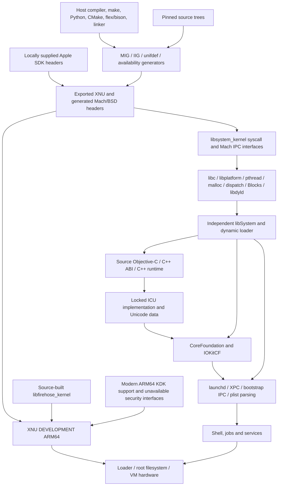

# Source and dependency audit

Audit date: 2026-10-10. Tracks #9 and the discovered dependency work in #15.

Two source profiles are deliberately separate. The modern Apple profile follows
the official macOS 26.5 distribution manifest. The virtual-machine experiment
uses PureDarwin's pinned `next` tree, including its older XNU and runtime changes.
Combining their headers, runtime libraries, or hardware interfaces into a third
profile has not been validated. The complete commit and tree identifiers are in
[sources.lock.json](../../sources.lock.json).

| Component | Compatible candidate | Source and build role | Observed state |
| --- | --- | --- | --- |
| Modern XNU | `xnu-12377.121.6`, `ac9718fb1af618d5ce8678d0dc6e8a58f252216f` | [Apple XNU](https://github.com/apple-oss-distributions/xnu/tree/ac9718fb1af618d5ce8678d0dc6e8a58f252216f); BSD/Mach/IOKit kernel and `libsyscall` interfaces | Header installation passes; ARM64 compilation encounters unavailable security headers |
| AvailabilityVersions | `157.2`, `149b1777f3e8c2133042d8e188f72e3adf6a7110` | [AvailabilityVersions](https://github.com/apple-oss-distributions/AvailabilityVersions/tree/149b1777f3e8c2133042d8e188f72e3adf6a7110); availability generator and public/private header templates | Source generator and installation pass |
| MIG/bootstrap tools | `bootstrap_cmds-138`, `c71d2d72f48995baaea76148f61002e5299841de` | [bootstrap_cmds](https://github.com/apple-oss-distributions/bootstrap_cmds/tree/c71d2d72f48995baaea76148f61002e5299841de); host interface generation | Modern header experiment uses installed Xcode MIG; PureDarwin compiles its own MIG |
| Modern dyld | `dyld-1378`, `fd8d0c4d52320ebf64db34f3cb280310d905c5ae` | [dyld](https://github.com/apple-oss-distributions/dyld/tree/fd8d0c4d52320ebf64db34f3cb280310d905c5ae); target dynamic loader and libdyld | Candidate from Apple's coherent release set; standalone runtime build unvalidated |
| Modern libSystem umbrella | `Libsystem-1356`, `c23b51183e46e613375dc7639fb4bf11fbf59ba8` | [Libsystem](https://github.com/apple-oss-distributions/Libsystem/tree/c23b51183e46e613375dc7639fb4bf11fbf59ba8); initialization and aggregate runtime | Component dependencies must be built; the repository is not the complete runtime |
| Modern libc | `Libc-1752.120.2`, `4e34d0559e3a1b081afeb8604d9e204a1f31321d` | [Libc](https://github.com/apple-oss-distributions/Libc/tree/4e34d0559e3a1b081afeb8604d9e204a1f31321d); C/POSIX interfaces | Candidate; runtime validation separate |
| Modern libplatform | `375.120.2`, `b7ed7cf5cf7dd12b98672435db2225a860f199d8` | [libplatform](https://github.com/apple-oss-distributions/libplatform/tree/b7ed7cf5cf7dd12b98672435db2225a860f199d8); atomics, locks and low-level runtime | Candidate; runtime validation separate |
| Modern libpthread | `539.100.4`, `1f4f5265b319111142f1bf3a27d4484ef5a98314` | [libpthread](https://github.com/apple-oss-distributions/libpthread/tree/1f4f5265b319111142f1bf3a27d4484ef5a98314); thread runtime | Candidate; runtime validation separate |
| Modern libmalloc | `812.100.31`, `c49dafa25f1efe8607701ae6014a663ad2ee437f` | [libmalloc](https://github.com/apple-oss-distributions/libmalloc/tree/c49dafa25f1efe8607701ae6014a663ad2ee437f); allocation | Candidate; runtime validation separate |
| Modern libdispatch | `1542.100.32`, `701f4d1a24ae9c6863901bbbb22624b7d1b87321` | [libdispatch](https://github.com/apple-oss-distributions/libdispatch/tree/701f4d1a24ae9c6863901bbbb22624b7d1b87321); dispatch and kernel firehose | Public dependency; modern kernel firehose not yet built |
| VM kernel/runtime/init | PureDarwin `next`, `1bbaeb2ee6aa41e6f792a0b1e2943cc295b3b290` | [PureDarwin](https://github.com/PureDarwin/PureDarwin/tree/1bbaeb2ee6aa41e6f792a0b1e2943cc295b3b290); integrated sources and compatibility code | DEVELOPMENT ARM64 VIRT kernel built; independent runtime/VM testing tracked separately |
| VM boot assets/tools | `xnu-loader`, `kc-tools`, `iig-tools` | Explicit lock entries plus [upstream flake lock](../../manifests/puredarwin-flake.lock) | Must be validated against the chosen kernel/root filesystem |

The matching Apple release set comes from its
[macOS 26.5 release manifest](https://github.com/apple-oss-distributions/distribution-macOS/blob/macos-265/release.json)
and gitlinks. Being released together is a candidate compatibility relationship,
not evidence that all components build independently.
The macOS 26.5 manifest has no modern `launchd` source project. A current Apple
runtime source set therefore does not automatically provide a source-built PID 1;
the candidate launchd comes from the separately pinned PureDarwin tree.

## Build order and runtime closure

The PureDarwin closure is concrete in its
[libSystem CMake file](https://github.com/PureDarwin/PureDarwin/blob/1bbaeb2ee6aa41e6f792a0b1e2943cc295b3b290/src/Libraries/libSystem/CMakeLists.txt),
[libSystem aggregate target](https://github.com/PureDarwin/PureDarwin/blob/1bbaeb2ee6aa41e6f792a0b1e2943cc295b3b290/src/Libraries/libSystem/stub/CMakeLists.txt),
[dyld target](https://github.com/PureDarwin/PureDarwin/blob/1bbaeb2ee6aa41e6f792a0b1e2943cc295b3b290/src/Libraries/dyld/CMakeLists.txt),
and [launchd target](https://github.com/PureDarwin/PureDarwin/blob/1bbaeb2ee6aa41e6f792a0b1e2943cc295b3b290/src/Libraries/XPC/launchd/CMakeLists.txt).
The aggregate target is named `libSystem_B_stub` upstream, but links the actual
source-built libraries; the target name alone does not establish independence.
The runtime additionally brings in resolver/account services, notify, ASL/syslog,
trace, Darwin support, SystemConfiguration, math/compiler builtins, Blocks,
unwind/C++ ABI, and crypto components as configured. The selected source launchd
requires CoreFoundation and IOKitCF; CoreFoundation in turn needs the source
Objective-C runtime and ICU. The measured ARM64 closure therefore includes real
Objective-C, C++ ABI, C++, ICU common/internationalization libraries, and Unicode
data, rather than treating them as optional future packages. The ICU 76.1 source
archive is separately locked and verified; the PureDarwin tree provides
CoreFoundation 1338. Their actual compile/link closure is recorded in the
[source build evidence](../../evidence/runtime/corefoundation/all-result.json).
XML and zlib remain dependent on selected targets. Exclude optional targets by a reviewed
build closure, then inspect the resulting Mach-O load commands; do not infer
runtime dependencies from compilation success. Further evidence belongs in the
runtime audit and VM boot results.

For a source-complete bootstrap, generators and host tools precede generated
headers; syscall/Mach interfaces precede libc/platform/threading/allocator;
those precede the runtime aggregate and loader; launchd's MIG interfaces, XPC
and its service dependencies precede a runnable PID 1. Kernel compilation may
proceed in parallel once headers and firehose are available. Boot assets depend
on an actual kernel and usable root filesystem, not just headers.

## Host inputs and target inputs

The experiment host is ARM64 macOS 27.2 build `26B5101f`, Apple Clang 21, and
Xcode 27.2 beta. The SDK is a proprietary, locally installed **build input**.
It is not copied into the target image or checked into the repository. The
[tooling capture](../../evidence/kernel/host-tooling.json) records resolved paths
and absent utilities. This host is newer than the modern macOS 26.5 source set
and PureDarwin's expected 11.3 SDK, so host SDK substitutions are experiments.

| Input class | Build host requirement | Target/runtime requirement |
| --- | --- | --- |
| Compiler/linker/build orchestration | Xcode clang/ld, make, Python, CMake; flex/bison and source-built helper tools | Compiler binaries are not required by a minimal booted server |
| SDK | Host headers and compiler declarations; inventory/hash locally supplied SDK | Target must use independently built runtime binaries; linking host libSystem fails the independence criterion |
| Generated headers/MIG | Regenerated from locked templates, `.defs`, syscall tables and generator source where available | Generated IPC/syscall implementations execute in kernel or userspace |
| KDK | Apple documents matching KDK as required for external modern ARM64 XNU builds | Modern build links machine-specific support archive into kernel; therefore it is more than a host convenience |
| Firmware/boot policy | Boot packaging/provisioning tools and a dedicated test device | Apple firmware and boot authorization remain hardware assumptions; they are not implemented by XNU source |
| Platform drivers | Source implementations need device descriptions and hardware research | Storage/DMA/interrupt/Ethernet drivers must operate on target hardware; QEMU VIRT support does not provide M1 support |

## Generated inputs and blocker register

| ID | Finding with observed evidence | Resolution or next action |
| --- | --- | --- |
| K-001 | Stock public SDK has no System.kext version; initial make fails before compilation | Pass source-profile Darwin version `RC_DARWIN_KERNEL_VERSION=25.5.0`; preserve original failure and replay command |
| K-002 | Missing `usr/local/libexec/availability.pl` | Build pinned AvailabilityVersions into local overlay; resolved |
| K-003 | Project-local SDK is not discoverable by xcrun metadata queries | Explicit `SDKROOT_RESOLVED`, `SDKVERSION` and `PLATFORMPATH` from audited host SDK; resolved for header installation |
| K-004 | Missing `usr/local/include/kernel`, `usr/local/include/iBoot`, private `AppleFeatures` and `platform` roots | Record actual absence; diagnostic build narrows warnings to reveal which interfaces are essential; no empty replacement headers supplied |
| K-005 | Essential `CoreEntitlements/V2/API.h`, `TrustCache/API.h`, `CodeSignature/Entitlements.h` absent during modern compilation | Genuine standalone source blocker. Obtain a lawful matching development input or implement/review source-compatible security subsystems; no permissive security stubs |
| K-006 | Modern ARM64 machine support archive referenced under KDK `System/Library/KernelSupport` | No KDK installed; match source/SDK/KDK and identify nonpublic archive contents before claiming independent modern kernel |
| K-007 | `libfirehose_kernel` and `libcc_kext` are later kernel link inputs | Public firehose source comes from libdispatch; PureDarwin successfully builds firehose and uses its reviewed kernel link configuration. Modern link not reached |
| K-008 | Optional CTF tools not shipped by the host Xcode lookup | Modern XNU disables unavailable CTF merge; PureDarwin builds its own dtrace CTF tooling. Optional debugging metadata, not proof of bootability |
| VM-001 | Pinned PureDarwin Nix input requires exact proprietary `MacOSX11.3.sdk.tar.xz` hash `9adc1373d3879e1973d28ad9f17c9051b02931674a3ec2a2498128989ece2cb1` | Locally supply the lawful input for the unmodified profile, or create a separately locked and tested SDK adaptation; modern SDK experiment is distinct |
| VM-002 | Upstream source contains compatibility/security stubs and optional components | Review each source-built component and prove target dynamic dependencies and service behavior. See PureDarwin reuse audit |
| HW-001 | Native M1 platform drivers, boot assets and firmware contracts are not established by VM kernel success | Track physical boot and P0/P1 hardware bring-up gates separately |

The source generator inventory includes AvailabilityVersions templates/DSL,
`bsd/kern/makesyscalls.sh` and syscall tables, `make_posix_availability.sh`,
`make_symbol_aliasing.sh`, MIG `.defs`, IIG `.iig`, configuration/assym generation,
unifdef exports, denylist generators, version generation and symbol-set tooling.
XNU includes an `EXTERNAL_HEADERS` directory specifically for dependency-cycle
avoidance. Each observed missing input above is classified instead of silently
resolved with host runtime binaries. Evidence is in
[header regeneration](../../evidence/kernel/headers/result.json),
[modern build blockers](../../evidence/kernel/resolved-includes/build-result.json),
and [genuine VM kernel build](../../evidence/kernel/puredarwin-result.json).

APSL and other component notices apply independently of blauOS's MIT license.
AvailabilityVersions templates contain APSL-2.0 notices; its generator tooling
has no repository-level license file detected in this checkout and needs a
notice review. Public source availability alone is not a redistribution grant
for Apple's SDK, KDK support archives or proprietary firmware.
